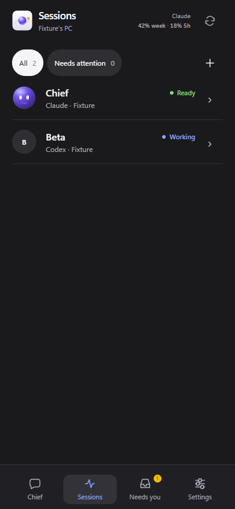
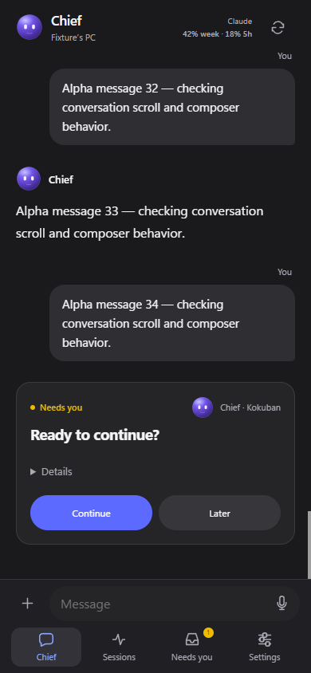

# Kokuban

Kokuban is a coordination server for AI coding agents. It gives every Claude Code, Codex and
Kimi Code session on a PC a shared board with presence, messaging, resource locks, task
hand-off and a shared knowledge base, exposed as MCP tools.

Kokuban (黒板) is the Japanese word for blackboard.

<p>
  
  
</p>

The phone page, with test data: the session list, and a question that waits for the person.

## Features

- `peers` gives each session a unique name and lists the other sessions with their project,
  status and claims.
- `send` addresses one session, every session in a repository, or every session on the PC.
  `inbox` reads mail and can wait for a reply. Direct mail can wake an idle session.
- `claim` reserves a named resource such as `port:3000` or `merge:main` atomically. A claim
  ends on `release`, when the session ends, or after two hours without contact.
- `task` hands work to another session and tracks it through offer, acceptance, progress and
  result.
- `ask` sends one question to the person, who answers in the Windows app or on a phone. The
  answer returns to the session that asked.
- `vault` reads and writes an Obsidian knowledge base. Writes are queued and applied by a
  single keeper process.
- `remote` reaches sessions and tasks on paired PCs over Tailscale.
- A Windows app and a phone page list what needs a person, running work and history.

## Requirements

- Windows 10 or 11
- Node.js 20 or later
- Claude Code or Codex. Kimi Code is supported with a separate activation step.
- Tailscale, for use across PCs only
- PowerShell and the .NET SDK, to build the Windows app only

## Installation

```
git clone https://github.com/52kokada/kokuban-agent-board.git kokuban
cd kokuban
npm ci
node dist/src/cli.js install
```

`install` registers the MCP server and lifecycle hooks with Claude Code and Codex and adds a
start-up entry for the daemon. `node dist/src/cli.js uninstall` removes them.

- Kimi Code: see [docs/kimi-code.md](docs/kimi-code.md).
- Updates, the Windows app and pairing a second PC: see [docs/setup.md](docs/setup.md).

## Usage

Agents call the board through MCP. A session passes its board name as `me`, or `"new"` on its
first call.

```
peers(me="new")
claim(me="Reef", what="port:3000")
task(me="Reef", op="status", id="...")
release(me="Reef", what="port:3000")
```

| Tool | Purpose |
|---|---|
| `peers` | Register, list sessions, record what this session is doing |
| `send`, `inbox` | Mail between sessions |
| `claim`, `release` | Locks on named resources |
| `task` | Hand-off with states and a result |
| `ask` | A question for the person |
| `know`, `vault` | Shared know-how and the knowledge base |
| `remote` | Sessions and tasks on a paired PC |
| `glance`, `context` | Compact views of the board and of earlier work |

[docs/reference.md](docs/reference.md) describes each tool in full.

## How it works

One daemon runs per PC and serves MCP and the agent hosts' lifecycle hooks. No hook starts a
process for each tool call, and a board with nothing to deliver adds nothing to a session's
context. [docs/architecture.md](docs/architecture.md) describes the processes and data flow.

- Mail delivery is at least once. A message offered through a hook counts as delivered when
  the next event from the same session confirms it. Unconfirmed mail is offered again after 90
  seconds, including after a restart.
- Board state is written with `fsync` followed by a rename (`src/board.ts`).
- The single-daemon lock is a named pipe, which the operating system releases when the process
  exits (`src/instance.ts`).
- The vault keeper applies queued writes with revisions and duplicate detection, and refuses
  text that looks like a credential (`src/vault-write.ts`).

## Documentation

- [docs/setup.md](docs/setup.md): installation, updates, pairing
- [docs/reference.md](docs/reference.md): behaviour of every tool
- [docs/architecture.md](docs/architecture.md): processes and data flow
- [docs/vault.md](docs/vault.md) and [docs/vault-keeper.md](docs/vault-keeper.md): the shared vault
- [docs/cross-pc-v5.md](docs/cross-pc-v5.md): the protocol between PCs

## Development

```
npm test
```

`npm test` builds the project and runs 645 tests against a temporary data folder. It does not
touch a board that is running on the same PC.

- Five tests are skipped until the native Windows helpers are built
  (`npm run build:agent-host`, `node scripts/build-chief-git.mjs`).
- `kokuban pair lists each PC` reads the version from git and needs a checkout with at least
  one commit.

| Path | Contents |
|---|---|
| `src/` | Daemon, MCP server, hooks, mail, claims, tasks, pairing, vault keeper |
| `src/phone/` | Phone page |
| `tests/` | Node test files |
| `app-windows/` | Windows app (C#, WinUI) and its tests |
| `tools/`, `vscode-session-launcher/` | Session launch helpers |

## Security

- Mail from another session reaches a model inside `<kokuban-message>` tags and is treated as
  data.
- By default, two sessions can exchange 40 messages before further mail between them is held
  until a person is consulted (the `loopLimit` setting).
- A request from a paired PC must carry a Tailscale identity. The daemon checks the caller's
  address with `tailscale whois` before it accepts the request (`src/peer.ts`).

To report a vulnerability, open a private security advisory on this repository.

## Project status

Kokuban is in daily use on a small number of Windows PCs. It is not packaged for other
platforms. Some identifiers in the vault code (`tobira_id`, the `computeruse` entry in the
updater) are specific to the installation it was written for and are not yet configurable.

This repository is a public copy of a private working repository. People, PCs, businesses and
addresses in tests, fixtures and docs are invented.

## License

[MIT](LICENSE)
